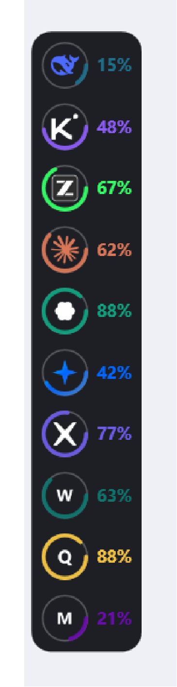

# Agent HUD · Windows

> A tiny always-on-top overlay that sits on the edge of your screen and shows the
> balance / quota of every AI agent you use. One icon per agent, wrapped in a progress
> ring that tracks its **tightest** remaining allowance. Dark rounded panel; hover to see
> percentages, click for details, drag it to any screen edge and it snaps there.

Windows 10 / 11 · pure PowerShell + WPF · no runtime to install (Node 18+ for the data source)

[中文说明](README.md) · **English**


---

## What it looks like

| Idle | Hover | Bent along the top edge |
|---|---|---|
|  |  |  |

- **One ring per AI provider** — the arc is that provider's most-constrained allowance
  (cash balance or a token package)
- **Hover** — the panel widens and shows the percentage next to each icon
  (digits only, colour matched to the ring)
- **Click an icon or its percentage** — a detail card appears with every balance item,
  package, expiry date and today's spend
- **Drag** — it slides along the screen edges; pushing it into the top/bottom edge bends
  the panel into a horizontal row (drag further = bend more)
- **Auto-hide** when another app goes fullscreen, **auto-show** when you come back

Ten providers at once:



---

## Quick start

### 1. Get the data source running (requires [Node.js](https://nodejs.org/) 18+)

```powershell
cd path\to\agent-hud-win
```

There are no npm dependencies — `snapshot.mjs` uses the built-in `fetch`.

### 2. Provide your API keys

Three options, highest priority first:

```powershell
# A. environment variables (simplest)
[Environment]::SetEnvironmentVariable('DEEPSEEK_API_KEY','sk-xxx','User')
[Environment]::SetEnvironmentVariable('MOONSHOT_API_KEY','sk-xxx','User')
[Environment]::SetEnvironmentVariable('ZHIPU_API_KEY','xxx','User')
# reopen your terminal / sign out and back in
```

```powershell
# B. a local private file (never committed — it is in .gitignore)
Copy-Item providers.local.json.example providers.local.json
notepad providers.local.json
```

**C.** If you use [DSH](https://github.com/) the keys are picked up straight from
`~/.dsh/.credentials.yaml` — nothing else to configure.

### 3. Start it

```powershell
# double-click (no console window):
start-silent.vbs

# or with a console attached, to see the log while troubleshooting:
start.cmd
```

Sanity check the data first if you like:

```powershell
node snapshot.mjs --check     # which providers have keys configured
node snapshot.mjs --pretty    # fetch once and dump the JSON
```

---

## Controls

| Action | Effect |
|---|---|
| `Ctrl + Alt + H` | show / hide |
| Run `start-silent.vbs` again | toggles visibility (it is both the launcher and the switch; it will not start a second copy) |
| Double-click the tray icon | show / hide |
| Right-click the tray icon | show/hide, refresh now, pause auto show-hide, reset position, autostart, quit |
| Hover | show percentages |
| Left-click an icon / percentage | expand that provider's detail card |
| Drag | slide along the screen edges, snaps to the nearest one on release |

**Autostart**: toggle it from the tray menu. A watchdog process (`watchdog.ps1`) also
keeps the main process alive — if it dies it is restarted within about a minute.

---

## Adding more agents

**No code required.** `providers.json` is a declarative table; one more JSON object adds
one more icon. See **[docs/ADD-PROVIDER.md](docs/ADD-PROVIDER.md)**.

Ships with built-in adapters:

| id | Provider | Ring colour | Env var |
|---|---|---|---|
| `deepseek` | DeepSeek | `#1F6F8B` | `DEEPSEEK_API_KEY` |
| `moonshot` | Kimi / Moonshot | `#8B5CF6` | `MOONSHOT_API_KEY` |
| `zhipu` | Zhipu GLM (cash + packages) | `#33FF66` | `ZHIPU_API_KEY` |
| `openrouter` | OpenRouter | `#F59E0B` | `OPENROUTER_API_KEY` |

Providers that have **no public balance endpoint** use the `manual` adapter — you put the
numbers in `providers.local.json`:

| id | Provider | Ring colour |
|---|---|---|
| `claude` | Claude | `#D97757` |
| `gpt` | GPT | `#10A37F` |
| `gemini` | Gemini | `linear-gradient(135deg, #00C6FF 0%, #0066FF 50%, #3A7BD5 100%)` |
| `grok` | Grok | `#6C5CE7` |
| `workbuddy` | WorkBuddy | `#0F766E` |
| `qwen` | Qwen | `#F5C542` |
| `minimax` | MiniMax | `#6A0DAD` |

> **Colours are fixed per provider** and come from the `color` field in `providers.json`.
> Besides a hex value, `color` accepts a CSS gradient
> (`linear-gradient(135deg, #00C6FF 0%, #0066FF 50%, #3A7BD5 100%)`) — the ring is painted
> with the gradient while the label keeps a solid colour (the middle stop) so small text
> stays readable.
> Low balance **does not** recolour the ring by default; set `"warnOnLowBalance": true` in
> `config.json` to bring back the “amber under 35%, red under 15%” behaviour.

Adding your own (example) — append this to `providers.json`:

```json
{
  "id": "my-llm",
  "label": "My LLM",
  "color": "#22C55E",
  "auth": { "env": ["MY_LLM_API_KEY"], "header": "Authorization", "scheme": "Bearer " },
  "request": { "url": "https://my-llm.example.com/api/balance" },
  "response": { "amountPath": "data.remain", "capacityPath": "data.total" }
}
```

The overlay gains one more row, with the ring drawn from `remain / total`.

---

## How it works

```
snapshot.mjs  ──every 60s──▶  %TEMP%\agent-hud-win.json  ──read──▶  hud.ps1 (WPF overlay)
  (fetches balances)              (a plain JSON file)              (never touches the network)
```

- **Network and UI are fully decoupled** — all HTTP happens in Node; the overlay only reads
  a local file, so the UI can never stall on a slow endpoint
- **Plaintext keys never leave the Node process memory** — not logged, not printed,
  not written to disk
- If a request fails, the last successful data is kept and flagged as stale instead of
  turning the ring red

---

## Configuration

Everything lives in `config.json`:

| Key | Default | Meaning |
|---|---|---|
| `circleSize` | 32 | ring diameter in DIP (physical px = this × display scaling) |
| `ringThickness` | 2.8 | arc width |
| `gap` | 10 | spacing between rows |
| `panelBackground` | `#F0101218` | panel colour (ARGB; first two digits are opacity) |
| `panelRadius` | 14 | corner radius |
| `cornerScale` | 1.5 | radius of the bending track; larger = rounder inner corner |
| `snapDistance` | 70 | how close to an edge before it snaps |
| `warnOnLowBalance` | false | recolour the ring amber/red on low balance |
| `warnRatio` / `lowRatio` | 0.35 / 0.15 | thresholds used by the above |
| `refreshSeconds` | 60 | polling interval |
| `allowProcessExact` | … | show the overlay while these apps are focused (add your IDE / terminal) |
| `hideWhenOtherFullscreen` | true | hide when another app is fullscreen |
| `providerIcons` / `providerColors` | … | fallback icon / colour maps |

Each provider in `providers.json` may also set `"reference": 20` — cash balances have no
vendor-imposed ceiling, so this is *your* idea of “full” and lets the ring draw a percentage.

---

## Troubleshooting

| Symptom | Cause / fix |
|---|---|
| Overlay does not appear | check `hud.log`; or the foreground app is classified as fullscreen |
| No percentages | 1) not hovering; 2) that provider has neither `ratio` nor `reference` |
| Ring is red | the query failed — hover to read the error, or run `node snapshot.mjs --pretty` |
| Ring is amber | remaining ≤ 35% (only when `warnOnLowBalance` is on) |
| Hotkey does nothing | another app grabbed it (the log says `hotkey FAILED`), or the process died — the watchdog restarts it, or run `start-silent.vbs` |
| `not configured` | that provider has no key set; it is skipped silently rather than shown as an error |

Debug switches (environment variables):

| Variable | Effect |
|---|---|
| `HUD_LABEL_DEBUG=1` | log each percentage label's text / visibility / colour |
| `HUD_RECT_DEBUG=1` | log each row's real screen rectangle (to verify click targets) |
| `HUD_CLICK_DEBUG=1` | log press / click / drag events |
| `HUD_FORCE_ACTIVE=1` | keep the hover state expanded (for screenshots/debugging) |
| `HUD_FORCE_MORPH=0..1` | force a bend progress |
| `HUD_PROVIDERS=a,b` | only enable the listed providers |

---

## Known limitations

- Only tested on **Windows 10/11 + Windows PowerShell 5.1** (built in — nothing to install)
- Every vendor's balance endpoint is private and may change without notice; if one breaks,
  adjust its parser in the `ADAPTERS` table of `snapshot.mjs`, or switch the provider to the
  pure-config `response` mapping
- The overlay is a layered window that polls mouse state, so in some remote-desktop / VM
  setups the pointer interaction may feel off

---

## Credits & trademarks

- Visual and interaction inspiration: [jazzenchen/agent-hud-open](https://github.com/jazzenchen/agent-hud-open)
  (macOS, Swift). This repository is an independent Windows implementation and contains none of its code
- Provider names and logos are trademarks of their respective owners. The icons in `icons/`
  are used only to identify the corresponding service; replace or remove them if you
  redistribute this project under stricter terms

## License

[MIT](LICENSE)
