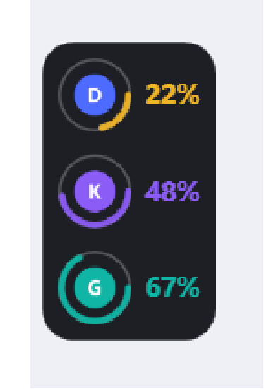
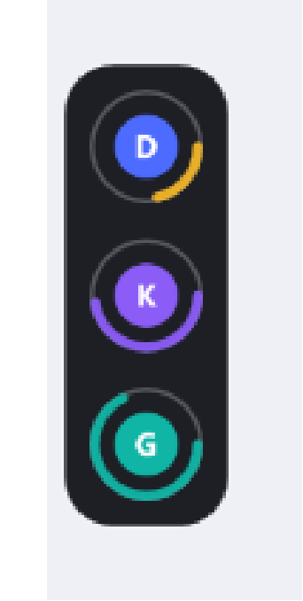
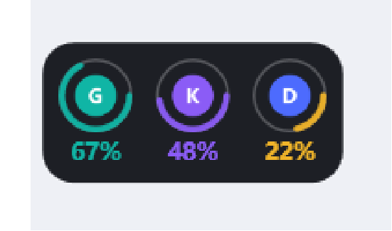

# Agent HUD · Windows

> 贴在屏幕边缘的 AI 用量浮窗。每个 agent 一个图标，外面套一圈进度弧，显示它**最紧的那项额度**。
> 深色圆角底，悬停展开百分比，点击看明细，拖到哪条边就吸附到哪条边。

Windows 10 / 11 · 纯 PowerShell + WPF · 不需要安装任何运行时（数据源需要 Node 18+）



---

## 它长什么样

| 安静时 | 悬停 | 打横贴边 |
|---|---|---|
|  |  |  |

- **每个圆圈 = 一个 AI 供应商**，圆环画的是它用量最高的那项额度（现金余额或资源包）
- **悬停**：浮窗变宽，图标旁出现百分比（只有数字，颜色与圆环一致）
- **点击图标或百分比**：旁边浮现明细框，列出全部余额 / 资源包 / 到期日 / 今日消耗
- **拖动**：贴着屏幕边框滑行；顶到上/下边界会像列车过弯一样弯折打横（推多少弯多少）
- **低量预警**：剩余 ≤35% 变黄、≤15% 变红
- **其他应用全屏时自动隐藏**，切回来自动出现

---

## 快速开始

### 1. 准备数据源（需要 [Node.js](https://nodejs.org/) 18+）

```powershell
# 在仓库目录里
npm install   # 本项目没有依赖，这一步其实可跳过
```

### 2. 配好你的 API key

三选一（优先级从高到低）：

```powershell
# 方式 A：环境变量（最省事）
[Environment]::SetEnvironmentVariable('DEEPSEEK_API_KEY','sk-xxx','User')
[Environment]::SetEnvironmentVariable('MOONSHOT_API_KEY','sk-xxx','User')
[Environment]::SetEnvironmentVariable('ZHIPU_API_KEY','xxx','User')
# 改完要重开终端 / 重新登录
```

```powershell
# 方式 B：本地私密文件（不会被提交，"providers.local.json" 已在 .gitignore 里）
Copy-Item providers.local.json.example providers.local.json
notepad providers.local.json
```

**方式 C**：如果你用 DSH，它会直接读 `~/.dsh/.credentials.yaml`，不用额外配。

### 3. 启动

```powershell
# 双击（无黑框）：
start-silent.vbs

# 或者带控制台看日志排错：
start.cmd
```

启动后检查一下数据对不对：

```powershell
node snapshot.mjs --check     # 哪些 provider 配好了 key
node snapshot.mjs --pretty    # 真拉一次，看返回结构
```

---

## 开关与操作

| 操作 | 效果 |
|---|---|
| `Ctrl + Alt + H` | 显示 / 隐藏 |
| 再双击一次 `start-silent.vbs` | 切换显隐（它同时是启动器和开关，不会多开） |
| 托盘图标双击 | 显示 / 隐藏 |
| 托盘右键 | 显示/隐藏、刷新数据、暂停自动显隐、重置位置、开机自启、退出 |
| 悬停 | 显示百分比 |
| 左键点图标 / 百分比 | 展开该 provider 的明细框 |
| 拖动 | 沿屏幕边框滑行，松手自动吸附最近边 |

**开机自启**：托盘菜单里的「开机自启」一键安装/卸载。默认还会有一个看门狗进程
（`watchdog.ps1`）盯着主进程，崩了 1 分钟内自动拉起。

---

## 多 agent / 加更多供应商

**不用改代码**。`providers.json` 是一张声明式表，加一段 JSON 就多一个图标。
详见 **[docs/ADD-PROVIDER.md](docs/ADD-PROVIDER.md)**。

已经内置好适配器的：

| id | 供应商 | 需要的环境变量 |
|---|---|---|
| `deepseek` | DeepSeek | `DEEPSEEK_API_KEY` |
| `moonshot` | Kimi / Moonshot | `MOONSHOT_API_KEY` |
| `zhipu` | 智谱 GLM（现金 + 资源包） | `ZHIPU_API_KEY` |
| `openrouter` | OpenRouter | `OPENROUTER_API_KEY` |

加一个新的（示例）：在 `providers.json` 里加

```json
{
  "id": "my-llm",
  "label": "我的模型",
  "color": "#22C55E",
  "auth": { "env": ["MY_LLM_API_KEY"], "header": "Authorization", "scheme": "Bearer " },
  "request": { "url": "https://my-llm.example.com/api/balance" },
  "response": { "amountPath": "data.remain", "capacityPath": "data.total" }
}
```

浮窗就多出一行，圆环按 `remain / total` 画。想加几个就加几个。

---

## 工作原理

```
snapshot.mjs  ──每60秒──▶  %TEMP%\agent-hud-win.json  ──读取──▶  hud.ps1 (WPF 浮窗)
   （联网查余额）                  （一个 JSON 文件）              （完全不联网）
```

- **网络和界面彻底分开**：所有 HTTP 都在 Node 里做，浮窗只读本地文件，界面永不被网络卡住
- **明文 key 只在 Node 进程内存里**，不写日志、不进输出、不落盘
- 断网 / 某个接口挂了：保留上次成功的数据并标灰，不会把圆环抹成红色

---

## 配置

主要改 `config.json`：

| 键 | 默认 | 说明 |
|---|---|---|
| `circleSize` | 32 | 圆直径（DIP；物理像素 = 它 × 系统缩放） |
| `ringThickness` | 2.8 | 进度弧粗细 |
| `gap` | 10 | 行间距 |
| `panelBackground` | `#F0101218` | 底色（ARGB，前两位是不透明度） |
| `panelRadius` | 14 | 圆角半径 |
| `cornerScale` | 1.5 | 弯折轨道圆角半径系数，越大内圈越圆 |
| `snapDistance` | 70 | 离边多近自动吸附 |
| `warnRatio` / `lowRatio` | 0.35 / 0.15 | 变黄 / 变红的阈值 |
| `refreshSeconds` | 60 | 刷新间隔 |
| `allowProcessExact` | … | 前台是这些程序时显示（加你的 IDE / 终端） |
| `hideWhenOtherFullscreen` | true | 其他应用全屏时隐藏 |
| `providerIcons` / `providerColors` | … | 每个 provider 的图标与颜色 |

`providers.json` 里每个 provider 还可以写 `"reference": 20`：现金余额没有厂商上限，
用这个「你心里的满额」让圆环有百分比（比如你一般充 20 块就写 20）。

---

## 排障

| 现象 | 原因 / 办法 |
|---|---|
| 浮窗不出现 | 看 `hud.log`；或者前台应用被判为「其他应用全屏」了 |
| 百分比不显示 | 1) 没悬停；2) 该 provider 既没有 `ratio` 也没有 `reference`（见文档） |
| 圆环是红色 | 查询失败，鼠标悬停能看到错误信息；`node snapshot.mjs --pretty` 看详情 |
| 圆环是黄色 | 剩余 ≤35%，正常预警 |
| 热键没反应 | 被别的程序占了（日志会写 `hotkey FAILED`）；或进程死了，等看门狗拉起或重启 |
| `未配置` | 该 provider 的 key 没设，会被静默跳过（不显示成错误） |

调试开关（环境变量）：

| 变量 | 作用 |
|---|---|
| `HUD_LABEL_DEBUG=1` | 日志打印每个百分比文字的文本/可见性/颜色 |
| `HUD_RECT_DEBUG=1` | 打印每行的屏幕矩形（核对点击命中区） |
| `HUD_CLICK_DEBUG=1` | 打印按下/点击/拖动事件 |
| `HUD_FORCE_ACTIVE=1` | 强制保持悬停展开（截图/调试用） |
| `HUD_FORCE_MORPH=0..1` | 强制指定弯折进度 |
| `HUD_PROVIDERS=a,b` | 只启用指定的几个 provider |

---

## 已知限制

- 只在 **Windows 10/11 + Windows PowerShell 5.1** 上验证过（系统自带，无需安装）
- 每个供应商的余额接口都是厂商私有的，随时可能变；变了就在 `snapshot.mjs` 的
  `ADAPTERS` 里改对应的解析，或改成纯配置的 `response` 映射
- 浮窗是分层窗口（layered window）+ 轮询鼠标状态，所以在某些远程桌面/虚拟机里
  鼠标交互可能不跟手

---

## 致谢与商标

- 视觉与交互灵感来自 [jazzenchen/agent-hud-open](https://github.com/jazzenchen/agent-hud-open)
  （macOS 版，Swift）。本仓库是独立的 Windows 实现，不包含其代码
- 仓库内的图标是**脚本生成的占位图**（品牌色圆 + 首字母），不含任何厂商 logo。
  各 AI 供应商的名称与商标归其各自所有者所有；如你要换成真实 logo，请自行确认授权

## 许可

[MIT](LICENSE)
